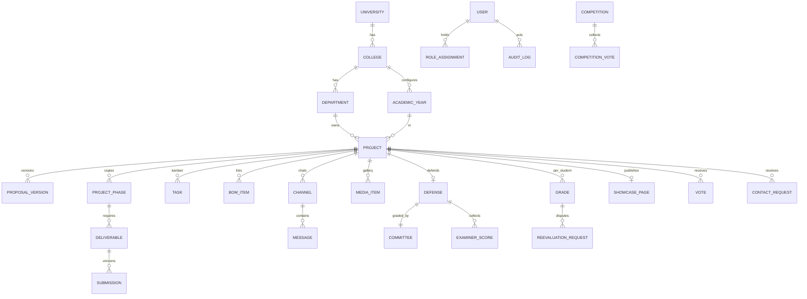

# Phase 1 Data Model: منصة مشاريع الطلاب

**Feature**: `001-student-projects-platform` | **Date**: 2026-11-23 | **Plan**: [plan.md](./plan.md)

MongoDB (Atlas) via Mongoose 8. Conventions for every collection unless noted:

- `_id: ObjectId`, `createdAt`, `updatedAt` (Mongoose `timestamps`).
- **Scope keys are denormalized** onto scoped documents (`collegeId`, `departmentId`,
  `academicYearId`, `projectId`) so the authorization `scopeFilter` is a direct indexed match
  (Principle II, VIII).
- `history[]` entries: `{ from, to, event, actorId, actorRole, comment, at }`.
- File references (`FileRef`): `{ publicId, url, resourceType: 'image'|'raw', deliveryType:
  'upload'|'authenticated', format, bytes, originalName }`.
- Link references (`LinkRef`): `{ kind: 'github'|'youtube'|'gdrive'|'other', url, title }`.
- No hard deletes on academic records; soft states noted per entity.
- Enumerations live in `shared/src/constants/*` and are imported by both Mongoose models and Zod
  schemas.
- Owning module shown in brackets.

---

## 1. Organization [organization]

### University (singleton)
| Field | Type | Rules |
|---|---|---|
| name, logo (FileRef) | string, FileRef | required name |
| settings.allowedEmailDomains | string[] | ≥1, lowercase, e.g. `mnu.edu.eg` (FR-013) |
| settings.minVoteAccountAgeHours | number | default 24 (FR-105) |
| settings.voteBurstPerIp10m | number | default 10 |
| settings.featuredProjectIds | ObjectId[] | admin-curated (FR-103) |

### College
| Field | Type | Rules |
|---|---|---|
| name | string | required, unique (case/normalized) |
| code | string | unique, short |
| status | enum `active`/`deactivated` | FR-010 (no delete) |
| settings.teamSizeMin / teamSizeMax | int | 1 ≤ min ≤ max ≤ 10 (FR-033) |
| settings.allowCrossCollege | bool | default false (FR-034) |
| settings.supervisorPrimaryCap | int | default 5 (FR-039) |
| settings.passMark | number | default 60 (FR-090) |
| settings.gradeSpreadThreshold | number | default 15 (FR-086a) |
| settings.reevaluationWindowDays | int | default 7 (FR-087) |
| settings.uploadLimits | `{maxBytes}` | ≤ 10 MB (R-10) |

Indexes: `{status:1}`, `{code:1}` unique.

### Department
`name, code, collegeId (ref), status active/deactivated`. Indexes: `{collegeId:1, status:1}`,
`{collegeId:1, code:1}` unique.

### AcademicYear (per college)
| Field | Type | Rules |
|---|---|---|
| collegeId | ObjectId | required |
| label | string | canonical `YYYY/YYYY` (e.g. `2026/2027`, validated `/^\d{4}\/\d{4}$/`) for cross-college reporting |
| startDate, endDate | Date | start < end |
| isCurrent | bool | at most one current per college (partial unique index) |
| semesters[] | `{name, startDate, endDate}` | within year |
| cycle.registrationOpensAt / registrationClosesAt | Date | FR-011, FR-031 |
| cycle.proposalDeadline | Date | ≥ registrationOpensAt |
| cycle.defenseStart / defenseEnd | Date | within year |
| status | `active`/`archived` | archive → projects read-only |

Indexes: `{collegeId:1, isCurrent:1}` partial unique where `isCurrent:true`; `{collegeId:1, startDate:-1}`.

---

## 2. Identity & Access [auth]

### User
| Field | Type | Rules |
|---|---|---|
| name | string | 2–100 chars |
| email | string | lowercase, unique **among non-released** accounts (see FR-013a) |
| emailReleased | bool | true after impostor deactivation → email freed |
| studentId | string? | unique sparse among non-released (students only) |
| passwordHash | string | bcrypt cost 12; never selected by default |
| mustChangePassword | bool | temp password flows (FR-015, FR-019) |
| tokenVersion | int | increments on password change/reset/deactivation |
| status | `active`/`pending`/`rejected`/`deactivated` | investors start `pending` (FR-017) |
| accountType | `student`/`staff`/`investor`/`visitor` | origin of registration |
| collegeId, departmentId | ObjectId? | home scope for students/staff |
| profile | `{ avatar FileRef, bio ≤500, skills[] ≤20, phone, socialLinks[] }` | FR-020 |
| privacy | `{ email:'private'|'public', phone:…, socialLinks:… }` | **default `private`** (Principle III) |
| investor | `{ organization, fieldOfInterest, reviewedBy, reviewedAt, rejectionReason }` | FR-017 |
| roles[] | RoleAssignment | see below |
| lastLoginAt | Date | |

**RoleAssignment** (embedded): `{ _id, role, scopeType, scopeId, collegeId?, departmentId?,
defenseId?, grantedBy, grantedAt }`
- `role` ∈ `universityAdmin, collegeAdmin, departmentAdmin, supervisor, committeeMember,
  student, investor, visitor`.
- `scopeType` ∈ `university, college, department, defense, self`.
- `external_examiner` invites grant `committeeMember` with `scopeType: 'defense', scopeId: defenseId` — permitted only on that defense's read/scoresheet/minutes endpoints and automatically expired once the defense reaches `finalized` (unless reopened for re-evaluation).
- Team leader/member, project supervisor/co-supervisor/mentor are **relationships on the
  project**, not stored roles (resolved by authz scope loaders).
- Project `collegeId`/`departmentId` are pinned at creation and do not change if a student later transfers departments.

Indexes: `{email:1}` unique partial `{emailReleased:false}`; `{studentId:1}` unique partial
`{studentId:{$exists:true}, emailReleased:false}`; `{'roles.role':1,'roles.collegeId':1}`;
`{'roles.role':1,'roles.departmentId':1}`; `{collegeId:1, departmentId:1, status:1}`;
`{status:1, accountType:1, createdAt:-1}` (investor approvals).

Validation: student sign-up email domain ∈ `university.settings.allowedEmailDomains`.

### RefreshToken
`userId, family, jtiHash, expiresAt, revokedAt?, replacedBy?, userAgent, ipHash`.
Indexes: `{jtiHash:1}` unique; `{userId:1, family:1}`; TTL `{expiresAt:1}` expireAfterSeconds 0.

### Invitation
| Field | Type | Rules |
|---|---|---|
| kind | `role`/`team`/`external_examiner` | FR-016, FR-033, edge case |
| tokenHash | string | random 32 bytes (256-bit entropy), SHA-256 stored; atomic `findOneAndUpdate` single-use |
| role, scopeType, scopeId, collegeId, departmentId | | for `role` kind |
| projectId | ObjectId | for `team` kind |
| defenseId | ObjectId | for `external_examiner` |
| createdBy, expiresAt (7 days), usedAt?, usedBy?, revokedAt? | | single-use |

Indexes: `{tokenHash:1}` unique; `{createdBy:1, createdAt:-1}`; TTL `{expiresAt:1}` +30 d.

---

## 3. Projects & Teams [projects]

### Project
| Field | Type | Rules |
|---|---|---|
| title | string | 5–200 chars |
| titleNormalized | string | `normalizeArabic(title)` (R-11) |
| slug | string | unique; collision → numeric suffix |
| idea, problem, objectives[], scope, expectedOutcomes, beneficiaries | string(s) | FR-030 |
| field | string (enum list in constants) | |
| type | `software/hardware/hybrid/research/design` | |
| keywords[] | string ≤ 15 | |
| cover | FileRef? | |
| collegeId, departmentId, academicYearId, academicYearLabel | ObjectId / string | from leader at creation (FR-034; `academicYearLabel` enables cross-college reports) |
| partnerCollegeIds[], partnerDepartmentIds[] | ObjectId[] | cross-college read-only (FR-034) |
| status | proposal machine state | `draft, submitted, under_review, needs_changes, supervisor_recommended, approved, rejected, withdrawn, archived` |
| history[] | StatusChange | FR-005, FR-037 |
| team | `{ leaderId, members[{userId, role:'leader'|'member', joinedAt, leftAt?, removedBy?, status:'active'|'left'|'removed'}] }` | |
| activeMemberIds | ObjectId[] | denormalized for indexing |
| preferredSupervisorId | ObjectId? | FR-038 |
| supervision | `{ primaryId?, coSupervisorIds[], mentorIds[], reviewerId? }` | FR-038/039 |
| supervisorIds | ObjectId[] | denormalized union (authz, dashboards) |
| ideaId | ObjectId? | adopted idea (FR-036) |
| progress | `{ percent, perPhase[{phaseId, percent}], computedAt }` | FR-056 |
| statusFlag | `on_track/at_risk/delayed` | FR-057 |
| defenseState | defense machine state | default `not_eligible` |
| supervisorSignOff | `{ by, at }?` | FR-082 |
| budgetEstimate | number | Σ BOM (private) |
| showcaseStats | `{ validVotes, votes7d, views7d, trendingScore, follows, bookmarks }` | private counters |
| isPublished | bool | mirror of showcase state for filters |

**Rules**:
- One active project per student per academic year (FR-030): enforced in service by checking
  `projects` where `academicYearId` = current and `activeMemberIds` contains user and `status ∉
  {rejected, withdrawn}`; plus partial unique collection `memberships` (below) for race safety.
- Team size max enforced at invitation; min at submission (FR-033).
- Editing proposal fields allowed only in `draft` and `needs_changes`.

Indexes: `{slug:1}` unique; `{collegeId:1, academicYearId:1, status:1}`; `{academicYearLabel:1, status:1}`;
`{departmentId:1, academicYearId:1, status:1}`; `{supervisorIds:1, academicYearId:1}`;
`{'supervision.primaryId':1, academicYearId:1, status:1}` (load cap);
`{activeMemberIds:1, academicYearId:1}`; `{field:1, academicYearId:1}`;
`{isPublished:1, 'showcaseStats.trendingScore':-1}`; `{isPublished:1, 'showcaseStats.validVotes':-1}`;
`{partnerCollegeIds:1}`; text index `{titleNormalized:'text', keywords:'text'}`
`default_language:'none'` (fallback); Atlas Search `projects_search`.

### ProjectMembership (race guard)
`{ userId, academicYearId, projectId, active: bool }` — unique partial index
`{userId:1, academicYearId:1}` where `active:true`. Set `active:false` on reject/withdraw/leave
before approval/admin removal.

### ProposalVersion
`{ projectId, version, snapshot{...proposal fields}, authorId, createdAt }`. Index
`{projectId:1, version:-1}` unique.

### TeamInvitation
`{ projectId, inviteeId?, invitationId? (link), invitedBy, status: pending/accepted/declined/cancelled/expired, respondedAt }`.
Index `{projectId:1, status:1}`, `{inviteeId:1, status:1}`.

### LeadershipTransfer
`{ projectId, fromUserId, toUserId, status: pending/accepted/declined/cancelled, at }` (FR-035).

### SupervisorAssignment (history)
`{ projectId, supervisorId, kind: primary/co/mentor/reviewer, assignedBy, overrideReason?, startedAt, endedAt? }`.
Index `{supervisorId:1, kind:1, endedAt:1}`. Cap override requires `overrideReason` + audit (FR-039).

### Idea (ideas bank) & AdoptionRequest
Idea: `{ title, description, field, type, ownerId, ownerKind: supervisor/investor, collegeId?, status: open/taken/removed, takenByProjectId?, removedBy?, removedReason? }`.
Index `{status:1, collegeId:1, createdAt:-1}`.
AdoptionRequest: `{ ideaId, requestedBy, projectId?, status: pending/accepted/declined, decidedAt }`.

#### Proposal state machine (FR-037)

```mermaid
stateDiagram-v2
    [*] --> draft
    draft --> submitted: SUBMIT (leader; window open; team ≥ min)
    submitted --> under_review: START_REVIEW (reviewing supervisor)
    under_review --> needs_changes: REQUEST_CHANGES (supervisor, comment required)
    needs_changes --> submitted: RESUBMIT (leader; before deadline)
    under_review --> supervisor_recommended: RECOMMEND (supervisor, comment)
    supervisor_recommended --> approved: APPROVE (dept/college admin) [audited]
    supervisor_recommended --> rejected: REJECT (dept/college admin, reason) [audited]
    supervisor_recommended --> needs_changes: RETURN (dept/college admin)
    draft --> withdrawn: WITHDRAW (leader)
    submitted --> withdrawn: WITHDRAW
    needs_changes --> withdrawn: WITHDRAW
    approved --> archived: YEAR_ROLLOVER (system)
    rejected --> [*]
    withdrawn --> [*]
```



Side effects: `APPROVE` → copy default active phase template (`NO_ACTIVE_PHASE_TEMPLATE` if none), create project channels (collaboration), lock memberships, cancel pending `TeamInvitation`/`AdoptionRequest` (primary supervisor assignment optional at `APPROVE`, required for supervisor-gated actions); `REJECT/WITHDRAW` → cancel pending `TeamInvitation`/`LeadershipTransfer`/`AdoptionRequest` and set `ProjectMembership.active = false`; deactivated leader blocks edits/transitions until Admin transfers leadership.
- Windows (`FR-011`, `FR-031`): `registrationClosesAt` gates `proposal.create` and initial `SUBMIT`; `proposalDeadline` (≥ `registrationClosesAt`) gates `RESUBMIT` from `needs_changes`.
- `START_REVIEW` (`submitted → under_review`) sets `supervision.reviewerId`; `REQUEST_CHANGES`/`RECOMMEND` require `under_review`. Admin `RETURN` (`supervisor_recommended → needs_changes`) requires `RESUBMIT` to re-pass Step 1 supervisor review.
- `ProposalVersion`: `v1` recorded on initial `SUBMIT` (with `ideaId` if adopted); `v(n+1)` on edits in `needs_changes` / `RESUBMIT`. Every transition → history + timeline event + notifications.

---

## 4. Tracking [tracking]

### PhaseTemplate (per college)
`{ collegeId, name, isDefault: bool, status active/archived, phases[{ key, name, order, weight, dueOffsetDays | dueDate, requiredDeliverables[{key, title, description, allowedTypes[]}], forms[FileRef] }] }`
Validation: Σ weights = 100 (FR-050). Template edits never touch existing project copies. Approval uses `isDefault` (or latest `active`) template; blocked (`NO_ACTIVE_PHASE_TEMPLATE`) if none active.

### ProjectPhase (per project copy)
`{ projectId, collegeId, departmentId, academicYearId, templateId, key, name, order, weight, dueDate, forms[], requiredCount, completedBySupervisor{by, at}?, milestones[{title, dueDate, done, doneAt}] }`
Rules: Supervisors may adjust `dueDate` and add milestones (`FR-051`), but cannot alter phase `weight` or delete required template deliverables. Index `{projectId:1, order:1}`.

### Deliverable
`{ projectId, phaseId, key, title, required: bool, dueDate, latestSubmissionId?, latestStatus: none/submitted/changes_requested/approved/rejected, ...scope keys }`
Rules: Only `required: true` deliverables enter `requiredCount` for completion %. Index `{projectId:1, phaseId:1}`, `{dueDate:1, latestStatus:1}` (reminders), `{collegeId:1, academicYearId:1, latestStatus:1}`.

### Submission (versioned)
`{ deliverableId, projectId, collegeId, academicYearId, academicYearLabel, version, isLatest: bool, files[FileRef], links[LinkRef], note, submittedBy, submittedAt, isLate, review?{ decision: approved/changes_requested/rejected, comment, reviewerId, at }, reviewHistory[] }`
Rules: new upload allowed when `latestStatus ∈ {none, submitted, changes_requested, rejected}` (supersedes unreviewed version; blocked if `approved` unless supervisor revokes first) (FR-052); `isLate = submittedAt > currentDeliverable.dueDate` (FR-053); `FR-125` late rate counts `isLatest: true` per deliverable; approved latest version drives progress. Index `{deliverableId:1, version:-1}` unique; `{collegeId:1, academicYearId:1, isLatest:1, isLate:1}`; `{academicYearLabel:1, isLatest:1, isLate:1}`; `{projectId:1, submittedAt:-1}`.

### Task (Kanban)
`{ projectId, title, description, column: todo/in_progress/review/done, order (fractional rank string), assigneeIds[], dueDate, createdBy, sourceMeetingId? }`
Index `{projectId:1, column:1, order:1}`. Does not affect progress (FR-056).

### BOMItem / ToolItem
BOM: `{ projectId, collegeId, academicYearId, academicYearLabel, item, quantity ≥1, specs, unitPrice ≥0, currency 'EGP', supplier, status: needed/ordered/received }`.
Tool: `{ projectId, collegeId, academicYearId, academicYearLabel, category: language/framework/library/service/other, name, version?, notes }`.
`projects.budgetEstimate` recalculated on BOM write (`shared/calc/budget.js`). Indexes `{projectId:1}`, `{collegeId:1, academicYearId:1}`, `{academicYearLabel:1}`.

### Meeting
`{ projectId, date, attendeeIds[], notes, actionItems[{text, assigneeId, taskId?}], createdBy }`. Index `{projectId:1, date:-1}`.

### TimelineEvent
`{ projectId, type (enum), actorId, refType, refId, summaryKey, data, at }` — `summaryKey`
points into `ar.timeline.*`. Index `{projectId:1, at:-1}`.

---

## 5. Collaboration [collaboration]

### Channel
`{ projectId?, kind: project_group/team_only/direct, memberIds[], members[{userId, lastReadAt}], title?, ...scope keys }`
Rules: `team_only` members = active team only (supervisors never) (FR-070); `direct` = exactly
one student + one of their supervisors. Index `{projectId:1, kind:1}`, `{memberIds:1, updatedAt:-1}`.

### Message
`{ channelId, senderId, text ≤ 4000, textNormalized, attachments[FileRef], replyToId?, mentions[userId], readBy[{userId, at}], removed{by, at, reason}?, editedAt? }`
Removed → text replaced by tombstone key in API output (FR-076). Index
`{channelId:1, createdAt:-1}`; Atlas Search `messages_search` (fallback: regex on
`textNormalized` scoped by `channelId`).

### Comment (threads on deliverables/tasks)
`{ targetType: submission/deliverable/task, targetId, projectId, authorId, text, parentId?, removed? }`. Index `{targetType:1, targetId:1, createdAt:1}`.

### Announcement
`{ authorId, scopeType: university/college/department/supervision, scopeId, title, body, audienceCount }` → fan-out notifications. Index `{scopeType:1, scopeId:1, createdAt:-1}`.

### Notification
`{ userId, type, titleKey, bodyKey, vars, link, readAt?, dedupeKey? }`. Index
`{userId:1, readAt:1, createdAt:-1}`; unique sparse `{dedupeKey:1}` (cron idempotency); TTL
partial on `readAt` > 180 d.

### MediaAlbum / MediaItem
Album: `{ projectId, title, order }`. Item: `{ albumId, projectId, kind: photo/video_link, file FileRef?, link LinkRef?, caption, visibility: private/public (default private), removed? }`.
Index `{projectId:1, visibility:1}`. Only `public` items are readable by showcase endpoints (FR-074, US4-6).

---

## 6. Evaluation [evaluation]

### Rubric (per college, per year)
`{ collegeId, academicYearId, name, supervisorPct, committeePct, criteria[{key, name, weight, appliesTo: team/individual, maxScore 100}], status: draft/active/locked }`
Validation: Σ criteria weights = 100; supervisorPct + committeePct = 100 (FR-080). Locked once any score exists.

### Committee
`{ projectId (or projectIds[] for batch), defenseId, chairId, memberIds[], externalExaminerIds[], createdBy }`
Rules (FR-083): primary/co-supervisor MUST NOT serve as committee chair or scoring committee examiners (they grade strictly via the supervisor component), and every committee must include at least one independent examiner besides the supervisor.

### Defense
| Field | Type | Rules |
|---|---|---|
| projectId, collegeId, departmentId, academicYearId | | |
| state | defense machine | optimistic guard on `state` + `__v` |
| scheduledAt, durationMin, room?, meetingLink? | | room or link required; `durationMin` default 60 (15–240) |
| committeeId | ObjectId | |
| minutes, recommendations | string | FR-088 |
| modifications | `{ required: bool, description, deadline, state: none/pending/confirmed/overdue, confirmedBy?, confirmedAt? }` | US5-7; independent of certificate download once `finalized` |
| spreadFlag | `{ exceeded, maxSpread, deliberationCount (≤3), note?, decidedBy? }` | FR-086a |
| history[] | | |

Indexes: `{collegeId:1, scheduledAt:1}`; `{room:1, scheduledAt:1}`; `{'committee members' via
committee}`; `{projectId:1}` unique per year. Conflict check: strict interval overlap (`startA < endB && startB < endA`, so back-to-back slots do not conflict) for same `room` (skipped when online-only without `room`) or any shared examiner → warning (FR-084).
Eligibility & scoring rules: revoking a deliverable approval while `eligible` regresses `defenseState` to `not_eligible` (blocked once `scheduled`); only active `supervision.primaryId` submits the supervisor score (if deactivated, admin must reassign before scoring/finalization); scoresheet covers `project.activeMemberIds` at `OPEN_GRADING` (removed/moved students excluded). `UNLOCK_FOR_REVISION` (≤3 rounds) unlocks all committee examiners for new score versions.

### ExaminerScore (versioned)
`{ defenseId, projectId, examinerId, component: supervisor/committee, version, teamScores{criterionKey: 0–100}, individualScores{studentId: {criterionKey: 0–100}}, totals{studentId: number}, submittedAt?, supersededAt?, reevaluationId? }`
Rules: hidden from other examiners until all submitted (FR-085); new version on deliberation
unlock or re-evaluation; never updated after `submittedAt` (new version instead). Index
`{defenseId:1, examinerId:1, version:-1}`; `{defenseId:1, supersededAt:1}`.

### Grade
`{ projectId, studentId, defenseId, collegeId, departmentId, academicYearId, academicYearLabel, version, isLatest: bool, supervisorTotal, committeeAvg, final, teamGrade, perCriterion[{key, supervisor, committeeAvg}], passed, band, locked, finalizedAt, finalizedBy, finalizeNote?, reevaluationId? }`
Rules: written only by `finalize` (marks prior version `isLatest: false` atomically); `locked:true` → immutable (model hook; R-09); reports & certificates query `{locked:true, isLatest:true}`. Index
`{projectId:1, studentId:1, version:-1}`; `{collegeId:1, academicYearId:1, locked:1, isLatest:1}`;
`{academicYearLabel:1, locked:1, isLatest:1}`; `{studentId:1, academicYearId:1}`.

### ReEvaluationRequest
`{ projectId, scope: 'student'|'project', studentId? (null for project-wide supervisor request), requestedBy, requesterRole: student/supervisor, reason (required), status: pending/approved/rejected/completed, decidedBy?, decidedAt?, decisionNote?, replacementCommitteeId?, oldGrades[], newGrades[] }`
Rules: ≤ 1 per `(project, student)` and ≤ 1 project-wide request (`studentId: null`, enforced by unique index `{projectId:1, studentId:1}`); service also blocks new requests when an active/completed project-wide request already exists; `scope: 'student'` allows revising only that student's Individual criteria (Team criteria stay locked so teammates are unaffected), while `scope: 'project'` allows Team + Individual revision; replacement committees obey COI (`FR-083`), spread (`FR-086a`), and prior supervisor score carry-over; once re-finalized (`completed`), no further requests allowed; within `college.settings.reevaluationWindowDays` of `finalizedAt`; only College Admin decides (FR-087).

#### Defense state machine (FR-082 – FR-088)

```mermaid
stateDiagram-v2
    [*] --> not_eligible
    not_eligible --> eligible: SIGN_OFF (supervisor) [all required phases approved]
    eligible --> scheduled: SCHEDULE (admin) [valid committee]
    scheduled --> scheduled: RESCHEDULE (admin)
    scheduled --> grading: OPEN_GRADING (chair / at scheduledAt)
    grading --> deliberation: UNLOCK_FOR_REVISION (chair) [spread exceeded]
    deliberation --> grading: RESUBMIT_SCORES (examiners, new versions)
    grading --> finalized: FINALIZE (chair) [all submitted; note if spread exceeded] [audited]
    finalized --> reevaluation_requested: REQUEST_REEVAL (student/supervisor) [window open, none before]
    reevaluation_requested --> reevaluation_open: APPROVE_REEVAL (college admin) [audited]
    reevaluation_requested --> finalized: REJECT_REEVAL (college admin) [audited]
    reevaluation_open --> finalized: FINALIZE (chair) [new grade version, old/new audited]
```

---

## 7. Showcase [showcase]

### ShowcasePage
| Field | Type | Rules |
|---|---|---|
| projectId (unique), slug (= project.slug) | | |
| state | `draft/pending_approval/published/unpublished/taken_down` | FR-102 |
| everApproved | bool | first publish approved → later edits go live directly |
| template | `classic/modern/minimal` (≥3) | FR-101 |
| theme | key from palette constants | |
| sections | `{ hero{slogan, cover}, problem, solution, features[], technologies[], components[] (names only), gallery (auto from public media), video LinkRef, team (auto; respects member privacy), supervisor (auto name), achievements[], interest }` | FR-100 |
| hiddenSections[] | string[] | |
| takedown | `{ by, reason, at }?` | audited |
| history[] | | |

Public projection (only when `state = published`): never includes grades, deliverables, BOM
prices/suppliers/budget, tasks, meetings, chat, private media, private contact fields, or `FR-013a`-released impostor accounts (FR-100a; normal deactivated/removed members keep historical credit without private contacts). Index `{slug:1}` unique; `{state:1, collegeId:1}`.

#### Showcase state machine
`draft → pending_approval (REQUEST_PUBLISH, team; project approved) → published (APPROVE,
supervisor, audited)`; `published → unpublished (UNPUBLISH, team) → published (PUBLISH, team,
everApproved)`; `published → taken_down (TAKE_DOWN, supervisor/admin, reason, audited) →
pending_approval (REQUEST_PUBLISH)`; project rejected or supervisor approval revoked → auto `taken_down` (archived year rollover stays visible read-only).

### Vote
`{ projectId, userId, status: valid/flagged/cleared/rejected, ipHash, createdAt, reviewedBy?, reviewedAt? }`
**Unique index `{projectId:1, userId:1}`** (user-mandated; SC-008). Index `{projectId:1, status:1, createdAt:-1}` (7-day trending), `{status:1, createdAt:-1}` (admin review).
Reconciliation: `FR-013a` impostor release sets `status: 'rejected'` and decrements `validVotes`; normal deactivation or later team/supervision join does not invalidate prior valid votes; takedown preserves vote records while rejecting new votes.

### Competition & CompetitionVote
Competition: `{ title, scopeType: university/college, scopeId, eligibleProjectIds[] | eligibility rule, voterRestriction: all/university_only, startsAt, endsAt, state: scheduled/open/closed, frozenRanking[{projectId, votes, rank}]? }`.
CompetitionVote: `{ competitionId, projectId, userId, status, ipHash }` unique
`{competitionId:1, projectId:1, userId:1}`. Isolated from general `Vote` / `showcaseStats.validVotes` / trending. Window is half-open `[startsAt, endsAt)` in UTC; voting/withdrawal blocked once `now >= endsAt`; lazy & scheduled freeze counts strictly `createdAt < endsAt` (FR-106).

### PageView
`{ projectId, visitorKey (hash of user id or ip+ua+day), day: 'YYYY-MM-DD' }` unique
`{projectId:1, visitorKey:1, day:1}`; index `{projectId:1, day:1}`; TTL 35 d (R-17).

### VoteIpCounter
`{ ipHash, window, count }` TTL 1 h (burst detection, R-19).

### Follow / Bookmark
`{ userId, projectId }` unique `{userId:1, projectId:1}` each; Index `{projectId:1}`.

### ContactRequest
`{ projectId, investorId, message, state: pending/accepted/declined/withdrawn, reply{ text, sharedContacts{ email?, phone?, other? } }?, decidedBy (must be leader), decidedAt }`
Index `{projectId:1, state:1}`, `{investorId:1, createdAt:-1}` (FR-107).

### Challenge
`{ investorId, title, description, field, status: open/closed/removed, removedBy?, removedReason? }` (published directly; also mirrored into ideas bank list).

### PublicComment
`{ projectId, authorId, text ≤ 1000, parentId?, state: visible/hidden/removed, reports[{userId, reason, at}], moderatedBy? }` Index `{projectId:1, state:1, createdAt:-1}`; `{'reports.0':1}` for moderation queue (FR-108).

---

## 8. Reports & Cross-cutting [reports, core]

### StatsCache
`{ kind: completion/supervisor_load/late_rate/evaluation/insights, yearKey (academicYearLabel for university scope, academicYearId for college/department), scopeType, scopeId, data, computedAt }` unique `{kind:1, yearKey:1, scopeType:1, scopeId:1}`.

### AuditLog (append-only)
`{ actorId, actorRole, action, targetType, targetId, scope{collegeId, departmentId, projectId}, before, after, reason?, ipHash, at }`
Catalog of audited actions across modules: `auth` (investor approve/reject, deactivate/reactivate, `releaseIdentifiers`, password reset, role assign/revoke, invite revoke), `organization` (college/dept CRUD/deactivate, settings, rollover, bulk import), `projects` (proposal `APPROVE`/`REJECT`/`RETURN`, post-approval team move/remove, admin leadership transfer, supervisor cap override, idea removal), `tracking` (phase template create/update, deliverable approval revocation), `collaboration` (admin content removal), `evaluation` (defense schedule/reschedule, `FINALIZE` incl. spread note, re-eval request/decide/re-finalize), `showcase` (first publish approve/reject, `TAKE_DOWN`, vote clear/reject, challenge removal, admin public comment moderation). Read-only exports/certificates are not audited; failed authz attempts log to `pino` security logs. `audit.service.js` redacts `passwordHash`, `temporaryPassword`, `tokenHash`, `jtiHash`, `ipHash`, and unshared personal contacts from `before`/`after`.
Indexes: `{'scope.collegeId':1, at:-1}`, `{targetType:1, targetId:1, at:-1}`, `{actorId:1, at:-1}`, `{action:1, at:-1}`. Model throws on update/delete.

### PendingUpload
`{ publicId, purpose, userId, projectId?, createdAt }` TTL 24 h (orphan cleanup).

### JobLock
`{ _id: jobName, lockedUntil, lockedBy }`.

---

## 9. Entity relationships (overview)



## 10. Validation rules → requirement map (selected)

| Rule | Where enforced | Req |
|---|---|---|
| Phase weights sum 100 | `shared/schemas/tracking.phaseTemplateSchema` (refine) | FR-050 |
| Rubric weights 100, split 100 | `shared/schemas/evaluation.rubricSchema` | FR-080 |
| Team size min/max | projects service (college settings) | FR-033 |
| Registration window | projects service + `shared/calc/windows.js` | FR-031 |
| Supervisor primary cap + override reason | projects service; audit | FR-039 |
| Late flag | tracking service at submit | FR-053 |
| Upload type/size | `shared/constants/fileTypes.js` + verifyUpload | FR-052, R-10 |
| Vote eligibility | `shared/calc/voteEligibility.js` + unique index | FR-104/105 |
| Re-eval window/once | evaluation service + unique index | FR-087 |
| Contact privacy default | User.privacy defaults; public projection | FR-020, FR-100a |
